# git-village

Draw one developer's public commits as a looping pixel-art city for their own GitHub profile README. Only public commits count, whichever token is used. Issues, reviews, pull requests, private commits, and calendar contribution totals do not count.

<p align="center">
  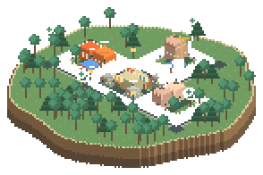
</p>

```html

```

Set up the nightly workflow in [Getting started](docs/getting-started.md). The composite Action requires published release binaries; until those exist, use the included workflow that installs from source.

```sh
cargo install --path .
git-village collect octocat --output snapshot.json
git-village render snapshot.json --output-dir village
```

Collection requires an authenticated [GitHub CLI](https://cli.github.com/). Rendering uses the snapshot alone, without network access or a clock. Outputs are `village.gif`, `village.png`, and `preview.html`, with transparent PNG and GIF exports cropped to the loop’s shared bounds plus a four-pixel native margin; scene exports are at least 768 × 512 pixels. The GIF never exceeds 1 MB: a loop over that renders again with less motion, and the city stops growing at roughly 600,000 commits.

The village is drawn on a transparent canvas, so it sits directly on GitHub's light or dark page. Add `--background scene` for the sky, sea, and status strip.

Lifetime public commits slowly grow the city in a circle from a central plaza, block by block; yearly commits control population; monthly commits control traffic; weekly commits control construction. Each building belongs to one language, weighted by that language's commits, so languages mix through every block. The status strip shows login, stage, commits, population, mood, and language swatches. See [the design](docs/design.md) for thresholds and mood rules. At the GitHub repository cap the collector splits windows, recording `detail_truncated` if a single day still hits the cap. Snapshots store no repository names.

Choose a look with `--setting`, or the Action's `setting` input. Earth is the default. Like the stills further down, these come from a sample account and use `--background scene`, with the status strip cropped out.

```sh
git-village render snapshot.json --output-dir village --setting mars
```

<table>
  <tr>
    <td align="center">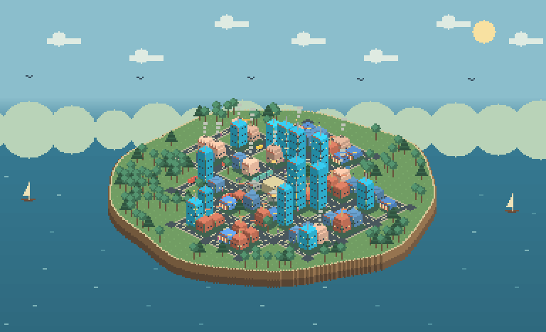<br><code>earth</code></td>
    <td align="center">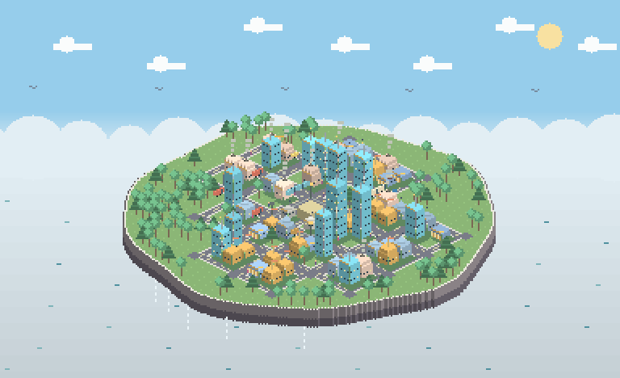<br><code>sky</code></td>
    <td align="center">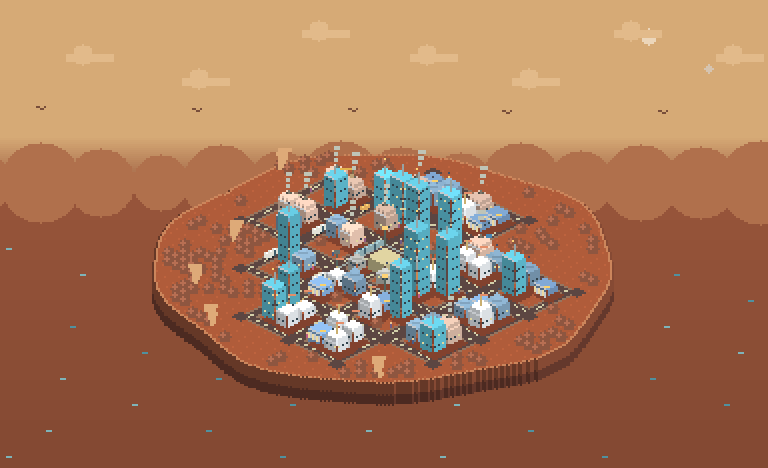<br><code>mars</code></td>
  </tr>
  <tr>
    <td align="center">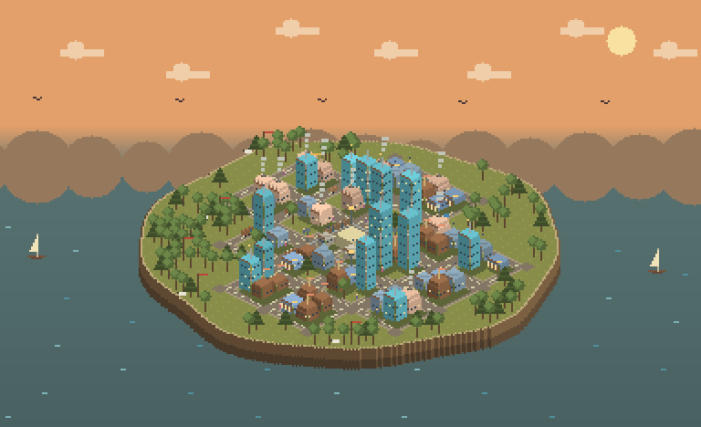<br><code>historic</code></td>
    <td align="center">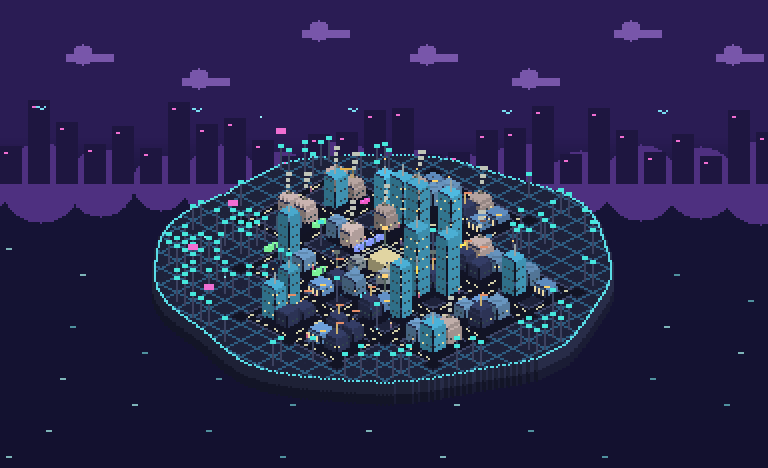<br><code>futuristic</code></td>
    <td align="center">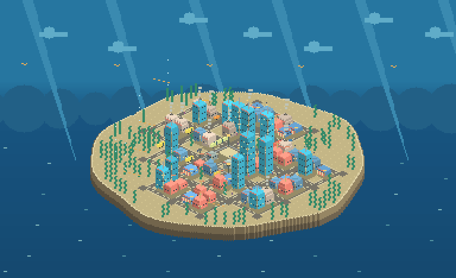<br><code>underwater</code></td>
  </tr>
  <tr>
    <td align="center">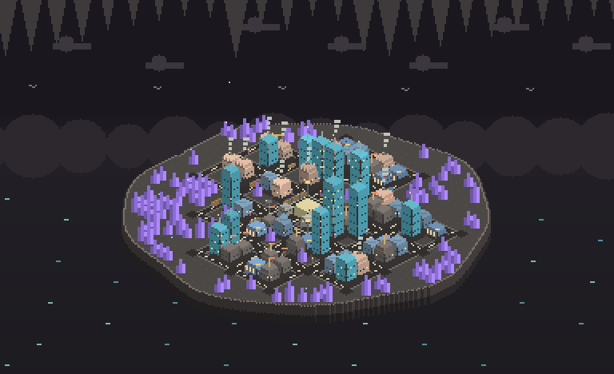<br><code>underground</code></td>
    <td></td>
    <td></td>
  </tr>
</table>

A village grows through six stages as lifetime commits add up.

<table>
  <tr>
    <td align="center">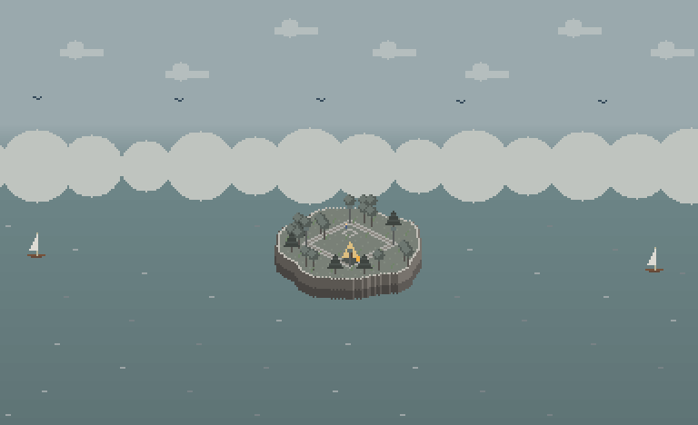<br>Outpost, 0 commits</td>
    <td align="center">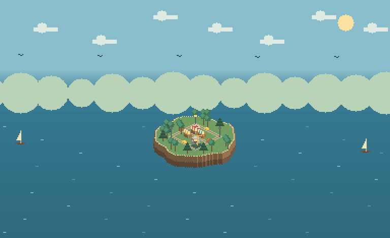<br>Hamlet, 100 commits</td>
    <td align="center">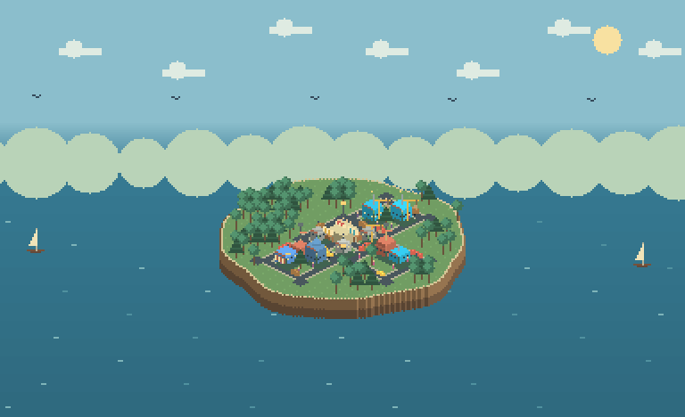<br>Village, 1,500 commits</td>
  </tr>
  <tr>
    <td align="center">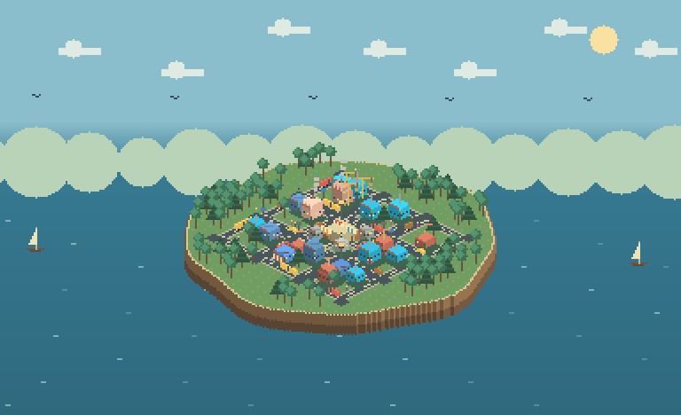<br>Town, 5,000 commits</td>
    <td align="center">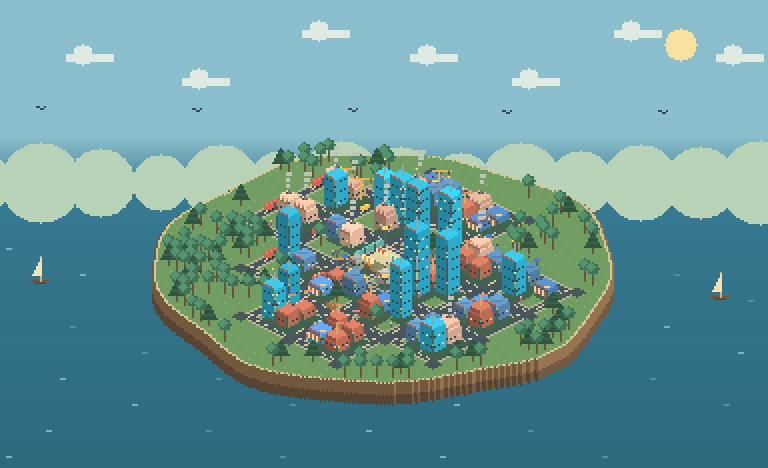<br>City, 20,000 commits</td>
    <td align="center">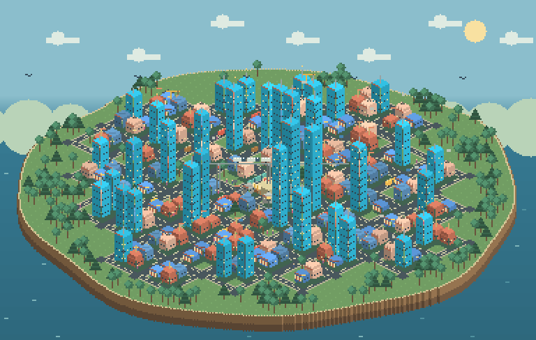<br>Metropolis, 100,000 commits</td>
  </tr>
</table>

The most recent commits set the mood of each day's loop. A fifth mood, Workday, is any other day.

<table>
  <tr>
    <td align="center">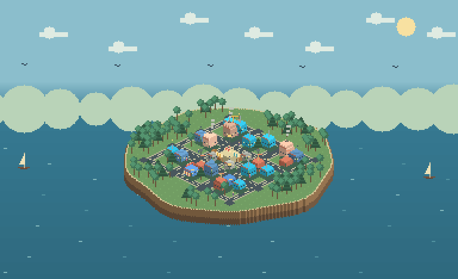<br>Market day, the first commit day of the week</td>
    <td align="center">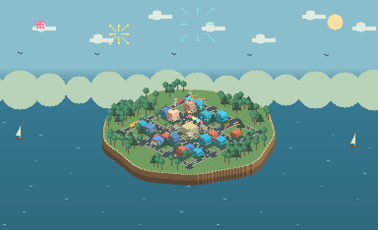<br>Festival, after a milestone or a busy week</td>
  </tr>
  <tr>
    <td align="center">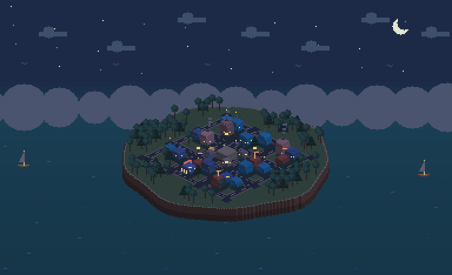<br>Night, after 14 quiet days</td>
    <td align="center">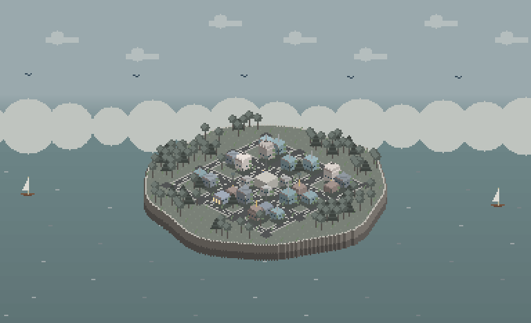<br>Abandoned, after 60 quiet days</td>
  </tr>
</table>

```sh
cargo fmt --check
cargo clippy --all-targets -- -D warnings
cargo test
cargo run --release --example generate-sheet -- target/review
```

The review generator writes contact sheets and six stage GIFs. The deterministic library exposes collection, snapshot validation, development, mood, setting materials, layout, depth rasterization, motion, rendering, and encoding as separate modules.

Inspired by [git-koi](https://github.com/yalongwastaken/git-koi), by Anthony Yalong. Adapted conventions and code are credited in [NOTICE](NOTICE).

MIT license, copyright Rei Tamaru. See [LICENSE](LICENSE).
